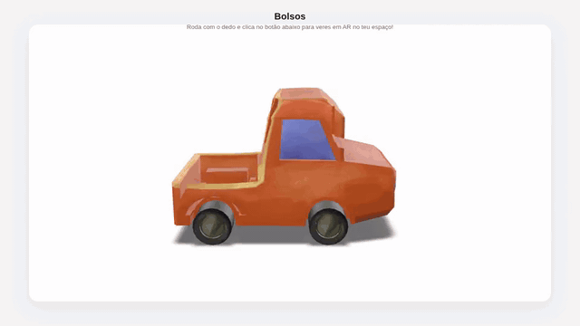

# Teste Google model-viewer

Visualizador 3D interativo com o componente `<model-viewer>` da Google, com passagem direta para realidade aumentada nativa no telemóvel (Scene Viewer no Android e AR Quick Look no iOS).

<p align="center">
  
</p>

> A animação é uma volta de 360° ao modelo, gerada a partir da demo publicada.

**Demo:** https://teste-site-google-model-viewer.vercel.app

Roda o modelo com o dedo e toca no botão "Ver no meu espaço" para o ver em AR no teu espaço.

## Como funciona

- `ar` e `ar-modes="webxr scene-viewer quick-look"` ativam o botão de AR e definem a ordem dos motores, para funcionar em Android e iOS.
- `camera-controls` permite rodar, inclinar e fazer zoom ao modelo antes de entrar na câmara.
- Por defeito mostra `02_Bolsos`; outro modelo escolhe-se com `?model=nome` (ficheiro `assets/nome.glb`).

## Tecnologias

HTML, CSS e JavaScript · Google `<model-viewer>` 3.5.0

## Estrutura

```
index.html                                         # página com o elemento <model-viewer>
assets/
└── 02_Bolsos.glb                                  # modelo 3D
qr-code Google-model-viewer 02_bolsos pag-12.png   # QR code para abrir a demo
docs/demo.gif                                      # animação deste README
README.txt                                         # documentação técnica
```

## Documentação técnica

Mais detalhes (configuração da câmara, escala e iluminação, como testar) em [`README.txt`](README.txt).
